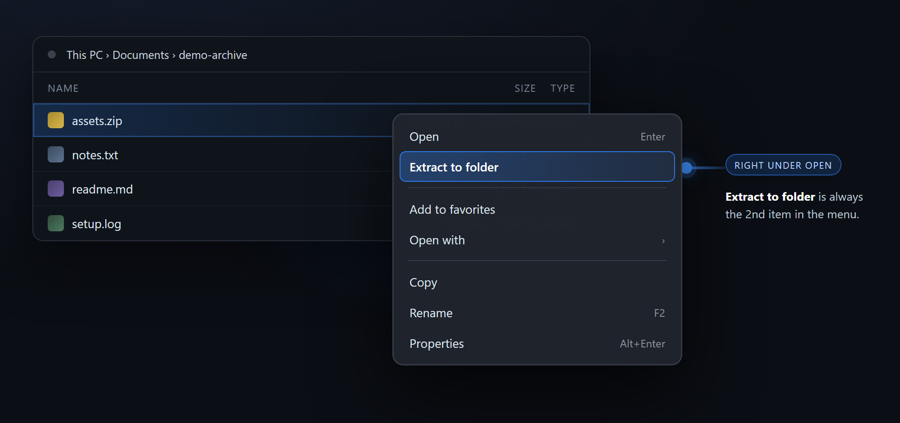
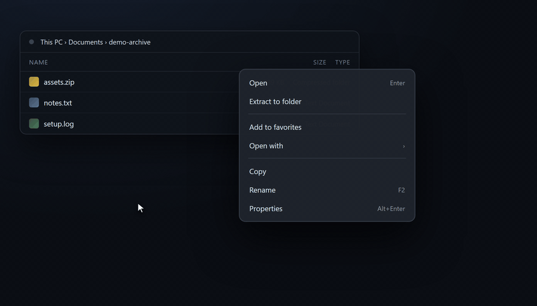
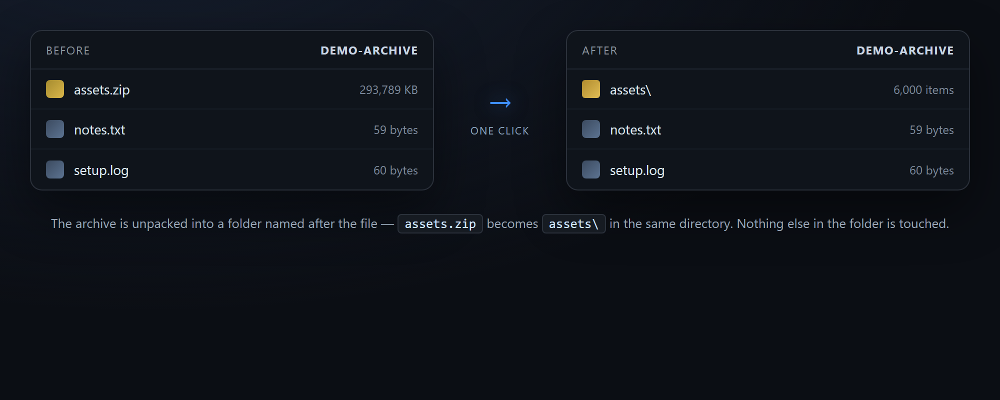

# Nilesoft Shell — Extract to Folder

**English** · [Türkçe](#türkçe)


Adds an **Extract to folder** command to the Windows right-click menu for compressed/archive files (`.zip`, `.rar`, `.7z`, `.tar`, `.gz`, `.bz2`, `.xz`, `.zst`, `.iso`, `.cab` and 30+ more). It appears directly under **Open** (2nd position) and extracts the archive into a folder named after the file, in the same directory (`file.rar` → `file\`).

Powered by [Nilesoft Shell](https://nilesoft.org/) + [7-Zip](https://www.7-zip.org/) — no extra runtime, no background service, just one config snippet.





## Requirements

- [Nilesoft Shell](https://nilesoft.org/) (installed and registered)
- [7-Zip](https://www.7-zip.org/) (`7zG.exe`)

## Install

### Automatic (PowerShell)

```powershell
powershell -ExecutionPolicy Bypass -File .\install.ps1
```

### Manual

1. Append the contents of [extract-zip.nss](extract-zip.nss) to your `shell.nss` file (below the `import 'imports/modify.nss'` line).
2. Refresh Explorer:

```cmd
shell.exe -restart
```

## Preview



The item is always the **2nd entry** in the menu, right under **Open**:

```text
Open
Extract to folder          <-- 2nd position (extracts straight into file-name\)
...
```

## Files

- `extract-zip.nss` — Nilesoft Shell menu definition
- `install.ps1` — locates Nilesoft Shell and 7-Zip automatically and installs the menu item
- `README.md` — usage documentation
- `LICENSE` — MIT license

## Back to the Classic Right-Click Menu (Windows 11)

To get the classic context menu on Windows 11 without the "Show more options" submenu:

```cmd
reg add "HKCU\Software\Classes\CLSID\{86ca1aa0-34aa-4e8b-a509-50c905bae2a2}\InprocServer32" /f /ve
taskkill /f /im explorer.exe & start explorer.exe
```

To restore the Windows 11 default menu:

```cmd
reg delete "HKCU\Software\Classes\CLSID\{86ca1aa0-34aa-4e8b-a509-50c905bae2a2}" /f
taskkill /f /im explorer.exe & start explorer.exe
```

## Notes

- If you previously added extract commands by hand to the `7-Zip.zip` or `CompressedFolder` registry keys, or have a `pos="bottom"` rule in `imports/modify.nss`, remove them — otherwise this item may appear twice or at the bottom of the menu.

---

## Türkçe

Windows sağ tık menüsünde sıkıştırılmış/arşiv dosyaları (`.zip`, `.rar`, `.7z`, `.tar`, `.gz`, `.bz2`, `.xz`, `.zst`, `.iso`, `.cab` vb.) için **Aç** seçeneğinin hemen altına (2. sıraya) **Klasöre çıkart** komutu ekler. Arşivi aynı dizinde kendi adıyla bir klasöre çıkarır (`dosya.rar` → `dosya\`).

### Gereksinimler

- [Nilesoft Shell](https://nilesoft.org/) (kurulu ve kayıtlı / `register` edilmiş)
- [7-Zip](https://www.7-zip.org/) (`7zG.exe`)

### Kurulum

#### Otomatik (PowerShell)

```powershell
powershell -ExecutionPolicy Bypass -File .\install.ps1
```

#### Manuel

1. [extract-zip.nss](extract-zip.nss) içeriğini `shell.nss` dosyanıza ekleyin (`import 'imports/modify.nss'` satırının altına).
2. Explorer'ı yenileyin:

```cmd
shell.exe -restart
```

### Önizleme

```text
Aç
Klasöre çıkart          <-- 2. sıra (dosya-adi\ içine doğrudan çıkartır)
...
```

### Dosyalar

- `extract-zip.nss` — Nilesoft Shell menü tanımı
- `install.ps1` — Nilesoft Shell ve 7-Zip yolunu otomatik bulup kuran script
- `README.md` — Kullanım dokümanı
- `LICENSE` — MIT lisansı

### Eski Menü Tarzına Dönüş (Windows 11 Klasik Sağ Tık Menüsü)

Windows 11'de "Daha fazla seçenek göster" alt menüsü olmadan klasik sağ tık menü tarzını açmak için:

```cmd
reg add "HKCU\Software\Classes\CLSID\{86ca1aa0-34aa-4e8b-a509-50c905bae2a2}\InprocServer32" /f /ve
taskkill /f /im explorer.exe & start explorer.exe
```

Windows 11 varsayılan modern menüsüne geri dönmek için:

```cmd
reg delete "HKCU\Software\Classes\CLSID\{86ca1aa0-34aa-4e8b-a509-50c905bae2a2}" /f
taskkill /f /im explorer.exe & start explorer.exe
```

### Notlar

- Daha önce `7-Zip.zip` veya `CompressedFolder` kayıt defteri anahtarlarına elle eklediğiniz eski çıkartma komutları ya da `imports/modify.nss` içinde `pos="bottom"` kuralı varsa kaldırın; aksi halde menüde çift veya en altta görünebilir.
